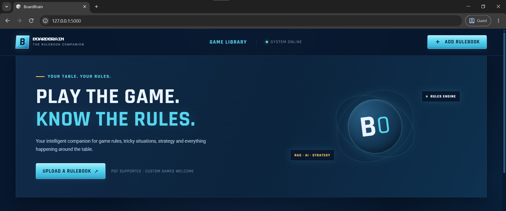
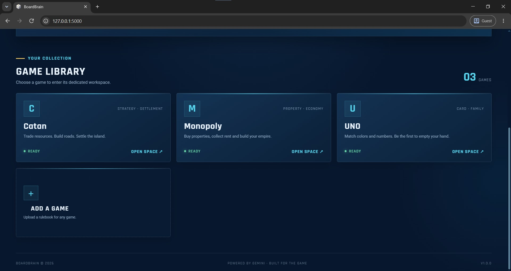
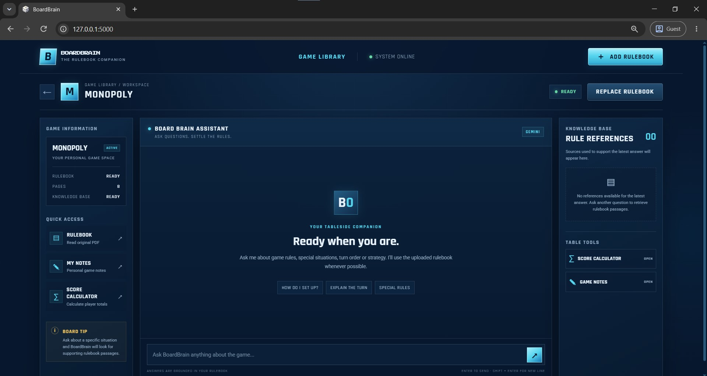
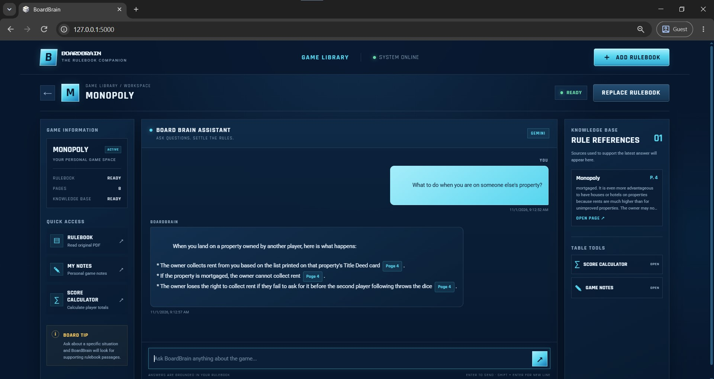
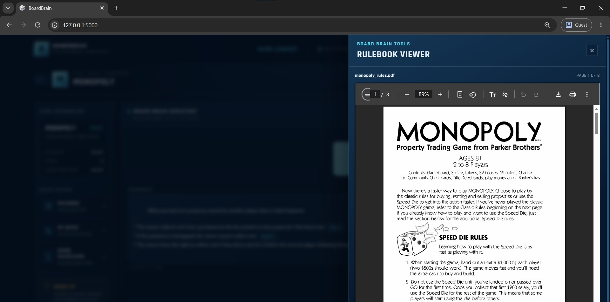
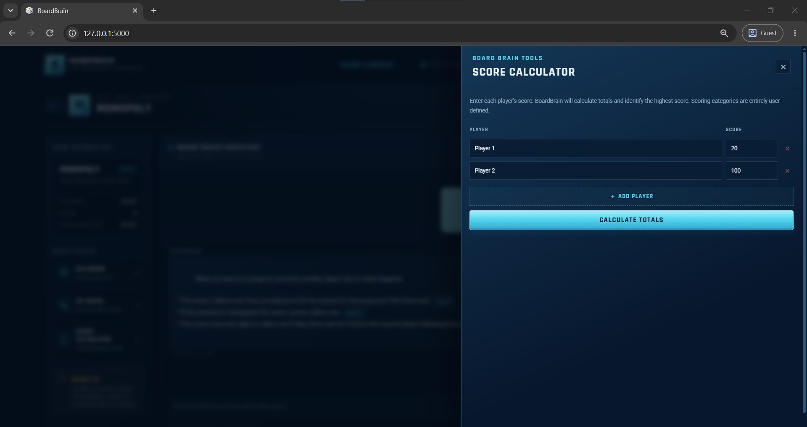
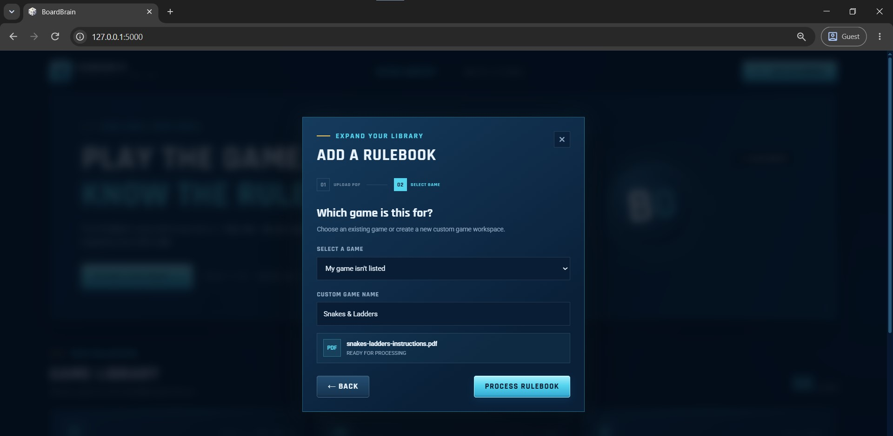

# BoardBrain – AI-Powered Board Game Rules Assistant

**BoardBrain** is an AI-powered board game companion designed to help players understand game rules, resolve gameplay-related questions, and manage their game sessions without repeatedly searching through lengthy rulebooks.

Built using Retrieval-Augmented Generation (RAG), Google Gemini, LangChain, FAISS, and LangGraph. BoardBrain retrieves relevant information directly from uploaded rulebooks and generates context-aware answers with page-level references.

The application supports both predefined board games and custom games. Players can upload their own rulebook PDFs, create a custom game, and build a dedicated knowledge base for it. The game library, uploaded rulebooks, and vector indexes are saved locally, allowing users to revisit previously added games without uploading their PDFs again.

---

## Features

### 1. AI-Powered Rulebook Assistant

- Ask natural-language questions about board game rules.
- Retrieve relevant information from the selected game's rulebook.
- Generate context-aware answers using Google Gemini.
- Display page-level references to help users verify the answers.
- Avoid inventing rules when relevant information cannot be found in the uploaded rulebook.

### 2. Retrieval-Augmented Generation (RAG)

- Extract text from uploaded PDF rulebooks.
- Clean and split extracted text into smaller, overlapping chunks.
- Generate semantic embeddings using Google's Gemini Embedding model.
- Store document embeddings in a local FAISS vector database.
- Retrieve the most relevant rulebook sections using similarity search.
- Pass retrieved context to Gemini for grounded answer generation.

### 3. Agentic AI Workflow

BoardBrain uses LangGraph to coordinate a structured AI workflow rather than relying on a single unverified LLM response.

The workflow consists of:

1. **Retrieval:** Retrieve relevant rulebook sections using the game's dedicated FAISS index.
2. **Generation:** Generate an answer using the retrieved context and the user's question.
3. **Verification:** Check whether the generated response is supported by the retrieved information.
4. **Conditional Retry:** If verification fails, the workflow can retry the generation process within the configured repair-attempt limit.
5. **End:** Return the verified response and its corresponding rulebook references.

The workflow uses a single coordinated agent pipeline with conditional execution and a bounded retry mechanism.

### 4. Multiple Board Game Support

BoardBrain initially provides three predefined games:

- Catan
- UNO
- Monopoly

Users can also upload custom rulebooks and add games that are not already available.

Each game maintains its own:

- Game information and metadata.
- Uploaded rulebook PDF.
- FAISS vector index.
- Notes.
- Associated knowledge base.

This ensures that information from one game is never accidentally mixed with another game's rulebook.

### 5. Persistent Custom Game Library

- Custom games are saved in a local SQLite database.
- Uploaded rulebooks are retained locally.
- FAISS indexes are stored separately for each game.
- Previously added custom games remain available after restarting the application or VS Code.
- Users do not need to upload and process the same rulebook every time they reopen BoardBrain.

This local persistence system makes the application reusable across multiple sessions.

### 6. Notes Management

- Save notes associated with individual games.
- Retrieve previously saved notes.
- Delete notes when they are no longer required.
- Keep notes separated by game.

### 7. Built-in Score Calculator

- Add players and enter their scores.
- Support multiple score categories for each player.
- Automatically calculate total scores.
- Sort players according to their total scores.
- Identify the highest-scoring player or players.

The calculator supports generic numerical score calculations. It does not independently validate game-specific scoring rules.

### 8. PDF Handling and Error Management

- Supports PDF rulebook uploads.
- Validates uploaded file types and file sizes.
- Extracts and cleans PDF text before indexing.
- Maintains page metadata for rulebook references.
- Handles missing rulebooks, invalid files, and empty extracted content.
- Provides fallback responses when relevant rulebook information cannot be retrieved.

---

## Technology Stack

| Component | Technologies Used |
|---|---|
| Frontend | HTML5, CSS3, JavaScript |
| Backend | Python, Flask |
| LLM | Google Gemini API |
| Embedding Model | Google Gemini Embedding |
| RAG Framework | LangChain |
| Agent Orchestration | LangGraph |
| Vector Database | FAISS (CPU) |
| Database | SQLite |
| PDF Processing | PyPDFLoader, pypdf, PyMuPDF |
| Text Processing | RecursiveCharacterTextSplitter, Regular Expressions |
| Data Validation | Pydantic |
| Environment Management | python-dotenv |
| Development & Testing | Jupyter Notebook, pandas |

### Key Technologies Explained

**1. Google Gemini API**

Used as the primary Large Language Model for generating natural-language answers from the retrieved rulebook context.

The chat model is configurable through the `.env` file, allowing different Gemini models to be tested without changing the overall application architecture.

**2. Google Gemini Embeddings**

Used to convert rulebook text chunks into numerical vector representations.

These embeddings capture semantic information, allowing BoardBrain to retrieve relevant rulebook passages even when the user's question does not contain the exact wording used in the original document.

**3. LangChain**

Used to simplify the RAG pipeline through document loading, text splitting, embedding integration, and vector store operations.

**4. FAISS**

FAISS is used as the local vector database.

Each game has an independent FAISS index, allowing semantic search to be performed against the correct rulebook without mixing information between games.

**5. LangGraph**

Used to define and coordinate the agent workflow.

It manages the retrieval, response generation, verification, conditional retry, and termination stages.

**6. Flask**

Acts as the backend web framework, connecting the HTML/CSS/JavaScript frontend with the Python-based RAG and agent pipeline.

It also exposes the application APIs used for game management, rulebook uploads, chat, notes, and score calculations.

**7. SQLite**

Used for persistent storage of game records, rulebook metadata, and game-specific notes.

Unlike browser-only storage, SQLite maintains the application's game library locally even after browser or application restarts.

---

## Application Architecture

BoardBrain follows a modular architecture that separates the frontend, backend, document-processing pipeline, agent workflow, and persistent storage.

### 1. Document Ingestion Pipeline

When a user uploads a rulebook:

1. The PDF is validated.
2. Text is extracted page by page.
3. Extracted text is cleaned.
4. Documents are split into overlapping chunks.
5. Each chunk receives metadata such as game ID, game name, filename, page number, and chunk index.
6. Gemini generates embeddings for the chunks.
7. The resulting vectors are saved in that game's dedicated FAISS index.
8. The rulebook metadata is stored in SQLite.

### 2. Question Answering Pipeline

When a user asks a question:

1. The selected game ID identifies the correct knowledge base.
2. The question is converted into a semantic retrieval query.
3. FAISS retrieves the most relevant rulebook chunks.
4. The retrieved context is passed to Gemini.
5. LangGraph coordinates answer generation and verification.
6. The final response is returned with the relevant rulebook page references.

### 3. Agent Workflow

```text
             User Question
                   |
                   v
          Retrieve Relevant Rules
                   |
                   v
           Generate AI Response
                   |
                   v
            Verify Response
                   |
              +----+----+
              |         |
           Verified   Not Verified
              |         |
              v         v
          Return     Conditional
          Answer       Retry
              |         |
              |    Retry Limit?
              |         |
              |    +----+----+
              |    |         |
              |   Retry    Stop
              |    |         |
              |    +---------+
              |         |
              +---------+
                    |
                    v
                   End
```

The number of repair attempts is configurable through the environment settings.

---

## Gemini Model Configuration

BoardBrain uses separate models for chat generation and document embeddings.

These models can be configured through the root `.env` file.

### Recommended Configuration

```env
GOOGLE_API_KEY=your_google_api_key

LLM_PROVIDER=google
EMBEDDING_PROVIDER=google

GEMINI_CHAT_MODEL=gemini-3.5-flash-lite
GEMINI_EMBEDDING_MODEL=gemini-embedding-001

MAX_REPAIR_ATTEMPTS=0
MAX_UPLOAD_SIZE_MB=30

FLASK_DEBUG=True
```

### Alternative Chat Models

If the current chat model experiences temporary availability issues, rate limits, or resource constraints, replace `GEMINI_CHAT_MODEL` with another supported model.

**Option 1 – Gemini 3.8 Flash**

```env
GEMINI_CHAT_MODEL=gemini-3.8-flash
GEMINI_EMBEDDING_MODEL=gemini-embedding-001
```

**Option 2 – Gemini 3.6 Flash**

```env
GEMINI_CHAT_MODEL=gemini-3.6-flash
GEMINI_EMBEDDING_MODEL=gemini-embedding-001
```

**Option 3 – Gemini 3.5 Flash-Lite**

```env
GEMINI_CHAT_MODEL=gemini-3.5-flash-lite
GEMINI_EMBEDDING_MODEL=gemini-embedding-001
```

**Option 4 – Gemini 3.1 Flash-Lite**

```env
GEMINI_CHAT_MODEL=gemini-3.1-flash-lite
GEMINI_EMBEDDING_MODEL=gemini-embedding-001
```

**Option 5 – Gemini 4 Argon**

```env
GEMINI_CHAT_MODEL=gemini-4-argon
GEMINI_EMBEDDING_MODEL=gemini-embedding-001
```

Model availability, API quotas, and rate limits may vary. A 503 error can also indicate temporary service capacity issues rather than an invalid model name.

### Important: Chat Model vs. Embedding Model

There is an important distinction between these two configurations.

- **Changing the chat model:** Does not require rebuilding the existing FAISS indexes, provided the embedding model remains unchanged.
- **Changing the embedding model:** Requires regenerating the embeddings and rebuilding the FAISS indexes for all existing games.

The existing project uses `gemini-embedding-001`. Do not change it casually because existing vectors were generated in that embedding space.

Google also provides `gemini-embedding-2`, but its embedding space is incompatible with `gemini-embedding-001`. Migrating to it requires re-embedding the rulebooks and rebuilding the indexes.

Official references:
- [Gemini API – Available Models](https://ai.google.dev/gemini-api/docs/models)
- [Gemini API – Embeddings](https://ai.google.dev/gemini-api/docs/embeddings)

### Retry Configuration

```env
MAX_REPAIR_ATTEMPTS=0
```

- `0`: Disables additional repair attempts while testing.
- `1`: Allows one additional attempt.
- `2`: Allows up to two additional attempts.

Use a lower value while debugging to reduce unnecessary API calls.

---

## Getting Started

### 1. Clone the Repository

```bash
git clone https://github.com/your-username/BoardBrain.git
cd BoardBrain
```

Replace the repository URL with the actual GitHub repository URL.

### 2. Create a Virtual Environment

```bash
python -m venv .venv
```

### 3. Activate the Virtual Environment (Windows)

```powershell
.venv\Scripts\activate
```

### 4. Install Dependencies

```bash
python -m pip install --upgrade pip
pip install -r requirements.txt
```

### 5. Configure the Gemini API Key

BoardBrain requires a Google Gemini API key.

1. Visit [Google AI Studio](https://aistudio.google.com/app/apikey).
2. Generate an API key.
3. Create a `.env` file in the root project directory.
4. Add your API key and the required model configurations.

Example:

```env
GOOGLE_API_KEY=your_actual_api_key

LLM_PROVIDER=google
EMBEDDING_PROVIDER=google

GEMINI_CHAT_MODEL=gemini-3.5-flash-lite
GEMINI_EMBEDDING_MODEL=gemini-embedding-001

MAX_REPAIR_ATTEMPTS=0
MAX_UPLOAD_SIZE_MB=30

FLASK_DEBUG=True
```

Never upload your actual `.env` file or API key to GitHub.

### 6. Run the Application

Make sure you are in the root `BoardBrain` directory and that your virtual environment is activated.

```bash
python app.py
```

Open the following URL in your browser:

```text
http://127.0.0.1:5000/
```

Flask serves the HTML page from the `templates` directory and the CSS, JavaScript, and image files from the `static` directory.

On initial startup, the application initializes its SQLite database and seeds the three predefined games.

---

## Using BoardBrain

### 1. Select a Game

Choose one of the predefined games:

- Catan
- UNO
- Monopoly

Alternatively, upload a rulebook for a custom board game.

### 2. Add a Custom Game

1. Select the rulebook PDF.
2. Choose **My game isn't listed**.
3. Enter the custom game's name.
4. Process the uploaded rulebook.
5. Open the game workspace.

The application processes the PDF using the same document ingestion, embedding, FAISS indexing, and retrieval pipeline used for the predefined games.

### 3. Ask Questions

Open a game's workspace and enter a question about its rules.

BoardBrain retrieves relevant rulebook sections and generates an answer with page references.

### 4. Manage Notes

Open the Notes section to save, view, and delete notes associated with the selected game.

### 5. Calculate Scores

Open the Score Calculator to add players, enter numerical scores, and calculate the totals and winners.

---

## Data Persistence and Resetting Custom Games

One of BoardBrain's key advantages is that the game library is stored locally instead of being recreated every time the application starts.

### Where Is the Data Stored?

| File / Directory | Purpose |
|---|---|
| `boardbrain.db` | SQLite database containing games, rulebook metadata, and notes |
| `documents/` | Stored rulebook PDFs |
| `vector_db/` | Persistent FAISS indexes, separated by game |
| `uploads/` | Upload and processing workspace |
| `static/` | Frontend assets such as CSS, JavaScript, and images |
| Browser `sessionStorage` | Current browser-session chat history, as implemented in the frontend |

### Resetting the Custom Game Library

BoardBrain includes a utility script:

```text
reset_custom_games.py
```

Whenever the following command is executed from the project root:

```bash
python reset_custom_games.py
```

It:

- Deletes all custom game records from the SQLite database.
- Deletes their associated notes and rulebook metadata.
- Removes their stored rulebook PDFs.
- Removes their associated FAISS index folders.
- Preserves the three predefined games: Catan, UNO, and Monopoly.
- Leaves the application's code, configuration, and ability to add future custom games unchanged.

**Important:** This script is intended for development and testing. Running it permanently removes the saved custom-game data and associated files.

If you want to back up the full application data before resetting, preserve `boardbrain.db`, `documents/`, and `vector_db/`.

The reset script does not need to be run during normal application usage.

---

## Project Structure

```text
BoardBrain/
│
├── templates/
│   └── index.html                  # Main HTML page
│
├── static/
│   ├── css/
│   │   └── style.css               # Website styling and UI design
│   │
│   ├── js/
│   │   └── app.js                  # Frontend interactions and API calls
│   │
│   └── images/
│       └── boardbrainlogo.png      # Brand logo and favicon
│
├── documents/                      # Stored game rulebook PDFs
│
├── uploads/                        # Upload and processing workspace
│
├── vector_db/                      # Persistent FAISS indexes
│   ├── catan/
│   ├── uno/
│   ├── monopoly/
│   └── <custom_game_id>/
│
├── notebooks/
│   └── 01_rulebook_inspection.ipynb # PDF extraction and chunk analysis
│
├── screenshots/                    # README application screenshots
│
├── app.py                           # Flask application and API routes
├── rag.py                           # PDF ingestion, embeddings and retrieval
├── agent.py                         # LangGraph agent workflow
├── tools.py                         # Score calculation and utility functions
├── schemas.py                       # Pydantic models and graph state schemas
├── database.py                      # SQLite database operations
│
├── reset_custom_games.py             # Reset custom games and their data
│
├── boardbrain.db                     # Generated SQLite database
├── requirements.txt                  # Python dependencies
├── .env                              # API keys and environment configuration
├── .env.example                      # Example environment configuration
├── .gitignore                        # Files excluded from Git
│
└── README.md
```

**Note:** `boardbrain.db` is generated automatically when the application initializes the database. The `vector_db` subdirectories are generated when rulebooks are processed. You do not need to manually create these files or indexes.

---

## Screenshots

The following screenshots demonstrate the main application interface and its functionality.

### 1. Home Page

The initial BoardBrain home screen, displaying the available board games and the option to add a custom game.



### 2. Game Library

The initial BoardBrain game library, displaying the available board games and the option to add a custom game.



### 3. Game Workspace

The main workspace where users can interact with the AI rulebook assistant.



### 4. AI Chat Assistant

A demonstration of the AI-generated response, including relevant rulebook page references.



### 5. Rulebook Viewer

The rulebook panel used to view the uploaded PDF and locate the referenced pages.



### 6. Score Calculator

The built-in numerical score calculator for managing player scores.



### 7. Adding a new game

Adding a new game which isnt available in the website.



---

## Future Work

- Introduce more predefined board games with their official rulebooks.
- Support additional document formats beyond PDF.
- Improve retrieval accuracy using advanced chunking and reranking techniques.
- Add persistent chat history across browser sessions.
- Introduce game-specific scoring templates and rule validation.
- Add export functionality for saved notes and game sessions.
- Explore deployment with persistent cloud storage and multi-user support.

---

## Author

**Abhishek Karthik**  
B.Tech – Computer Science and Engineering (Artificial Intelligence & Machine Learning)

Made with Python, Gemini, LangChain, LangGraph, and FAISS.